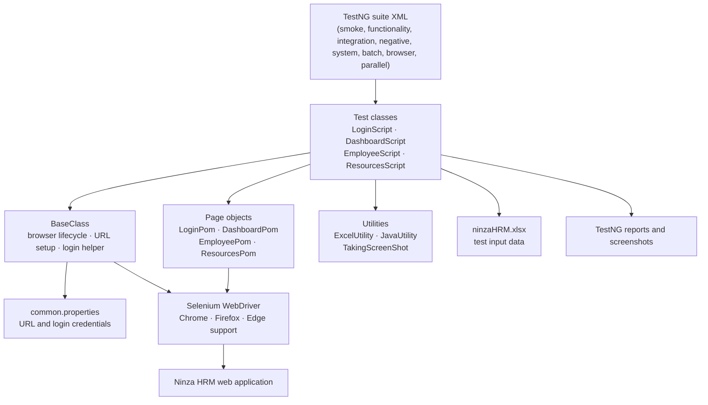
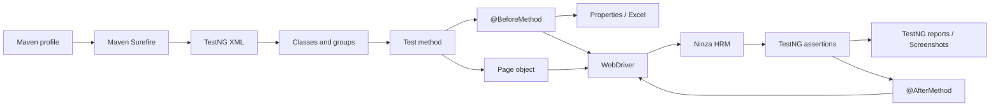
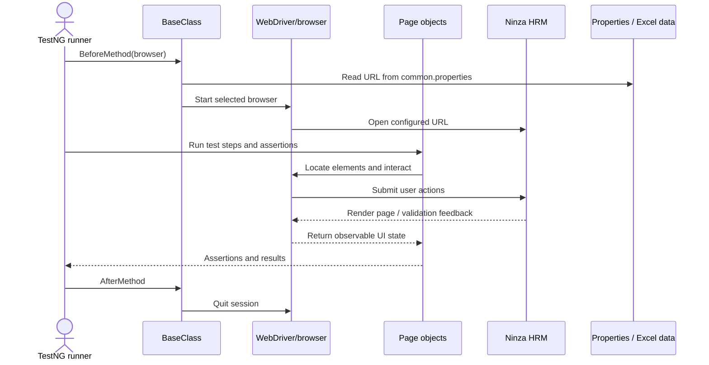

# Ninza HRM - Selenium Test Automation Project

Selenium WebDriver automation for the Ninza HRM web application. The project uses Java, Maven, TestNG, and Page Object Model (POM) classes to exercise login, dashboard, employee-management, and resources workflows.

> This repository contains the **test automation project**, not the Ninza HRM application itself. Tests require access to a reachable HRM environment and suitable test data.

## Project at a glance

| Area | Details |
| --- | --- |
| Build | Apache Maven |
| Language | Java 25 (configured in `pom.xml`) |
| Browser automation | Selenium Java 4.46.0 |
| Test framework | TestNG 7.12.0 |
| Page model | Selenium PageFactory-based page objects |
| Test data | Apache POI 5.4.1; `src/test/resources/ninzaHRM.xlsx` |
| Application URL | Configured in `src/main/resources/DDT/common.properties` |

## Coverage

Tests are organized by application area and positive/negative scenarios:

| Area | Current test coverage |
| --- | --- |
| Login | Login form controls, valid login, required-field validation, invalid username alert, and logout |
| Dashboard | Employee/project chart visibility, logout, and access after logout |
| Employees | Employee page and add form visibility, adding a valid employee, and duplicate employee rejection |
| Resources | Resources page visibility, file upload and filename search, missing-file search, and duplicate upload rejection |

Page objects also contain operations for employee search/edit/delete and resource search by upload date, download, and delete. Those helper operations are **not all exercised by the current test classes**.

## Tech Stack

- Java 25 (configured in `pom.xml`)
- Maven for dependency management and test execution
- Selenium Java 4.46.0
- TestNG 7.12.0
- Apache POI 5.4.1 for Excel-based test data
- Log4j Core 2.25.2
- JSON-Simple 1.1.1

## Project structure

```text
.
├── pom.xml
├── testng-*.xml                         # TestNG suite definitions
├── src/
│   ├── main/
│   │   ├── java/
│   │   │   ├── BaseClassUtility/
│   │   │   │   └── BaseClass.java       # Browser setup/teardown and login helper
│   │   │   ├── GenericUtility/
│   │   │   │   ├── ExcelUtility.java    # Read/write workbook cells
│   │   │   │   ├── JavaUtility.java     # Random-number helper
│   │   │   │   └── TakingScreenShot.java
│   │   │   └── PomClassesUtility/
│   │   │       ├── LoginPom.java
│   │   │       ├── DashboardPom.java
│   │   │       ├── EmployeePom.java
│   │   │       └── ResourcesPom.java
│   │   └── resources/
│   │       └── DDT/
│   │           ├── common.properties    # Environment URL and credentials
│   │           └── BatchExecution_TestNG_Report.html # Upload fixture used by resource tests
│   └── test/
│       ├── java/
│       │   ├── LoginScript/
│       │   ├── DashboardScript/
│       │   ├── EmployeeScript/
│       │   └── ResourcesScript/
│       └── resources/
│           └── ninzaHRM.xlsx            # Login and employee test data
├── pom.xml
├── testng-functionality.xml
├── testng-integration.xml
├── testng-negative.xml
├── testng-parallel_execution.xml
├── testng-regression.xml
├── testng-smoke.xml
├── testng-system.xml
├── testng-cross_browser.xml
├── Screenshots/                         # Screenshot output directory
├── test-output/                         # TestNG reports generated by test runs
├── .gitignore
└── README.md
```

## Core Architecture

The project is a **layered UI test automation framework**. TestNG controls which tests run, shared framework code owns browser setup, page objects encapsulate UI interactions, and utility classes provide reusable support for test data and screenshots. Selenium WebDriver drives the browser against the external Ninza HRM application.

This is a test framework, not a production web application: it has no application service/API layer or database implementation. The `BeforeSuite`/`AfterSuite` methods in `BaseClass` currently print database-lifecycle messages only; they do not establish a database connection.



### Framework layers and responsibilities

| Layer | Location | Responsibility |
| --- | --- | --- |
| Test selection | Root `testng-*.xml`; Maven profiles in `pom.xml` | Selects test classes, TestNG groups, browser parameters, and (for the parallel suite) parallel execution. |
| Test cases | `src/test/java/*Script/` | Describes user-visible scenarios and verifies outcomes with TestNG assertions. Positive and negative cases are separated by class. |
| Shared test base | `BaseClassUtility/BaseClass.java` | Creates the selected WebDriver before each test method, opens the configured URL, provides a reusable login helper, and quits the driver after each method. |
| Page objects | `PomClassesUtility/*Pom.java` | Encapsulates page locators and user actions behind page-specific methods; uses Selenium PageFactory and explicit waits where implemented. |
| Generic utilities | `GenericUtility/` | Reads/writes Excel test data, generates a random integer, and saves browser screenshots. |
| Configuration and fixtures | `src/main/resources/DDT/`, `src/test/resources/` | Holds the application properties, Excel workbook, and HTML file used by resource upload scenarios. |
| Browser/application boundary | Selenium WebDriver and Ninza HRM | WebDriver translates page-object actions into browser interactions; the application returns rendered UI state that tests assert. |
| Results | `test-output/`, `Screenshots/` | Stores TestNG reports and screenshots produced by negative test cases. |

### How the framework is used

1. **Select a suite.** A Maven profile points Surefire at a TestNG XML file. The XML chooses classes and may filter by a group such as `smoke` or `negative`.
2. **Start a fresh browser.** `BaseClass.openApplication()` runs before each test method, reads `url`, starts Chrome by default (or the browser parameter), sets a 20-second implicit wait, and opens the application.
3. **Prepare the scenario.** Test classes that need an authenticated session call `loginToApplication()` in a `@BeforeMethod`. Login tests may instead populate the login page themselves.
4. **Interact through a page object.** A test creates the page object with the current `driver` and calls semantic actions such as `getEmployee()` or `getLoginButton()`.
5. **Assert visible behavior.** TestNG `Assert` methods verify page elements, validation feedback, or resulting records. `Reporter.log()` adds context to TestNG output.
6. **Clean up.** `BaseClass.closeApplication()` quits the browser after each test method, including when a test fails.



### Module guide

#### `BaseClassUtility`

`BaseClass` is the shared test fixture inherited by all eight test classes. Its TestNG hooks wrap test execution and keep browser lifecycle consistent. `@Parameters("browser")` accepts a browser from suite XML; `@Optional("chrome")` makes Chrome the fallback. Browser-specific options disable password-manager prompts; Edge and Firefox are configured headlessly in this implementation.

`loginToApplication()` reads username/password properties, uses `LoginPom` to submit them, and fails with a runtime exception if the dashboard is not displayed. Use this helper from a test's setup when the scenario starts after authentication.

#### `PomClassesUtility`

Each page object owns locators and actions for one application page. Tests should use these methods rather than duplicating selectors in test classes.

| Page object | Main responsibilities |
| --- | --- |
| `LoginPom` | Enter credentials, submit login, request a demo, and check login/dashboard/validation elements. |
| `DashboardPom` | Check dashboard charts and trigger logout. |
| `EmployeePom` | Navigate employee management; search by name/email/phone; add, edit, and delete employee records; check duplicate rejection. |
| `ResourcesPom` | Navigate resources; search by filename or upload date; upload, download, or delete files; inspect error feedback. |

The page objects use PageFactory `@FindBy` locators. Some interactions use explicit `WebDriverWait` conditions; several simpler methods still call elements directly, so the actual wait behavior is method-specific.

#### `GenericUtility`

- **`ExcelUtility`** reads a cell from `ninzaHRM.xlsx` by sheet, row, and column, formats values as strings, and can write a value back to the workbook.
- **`JavaUtility`** supplies a random integer; the employee creation test appends one to a username to reduce duplicate usernames.
- **`TakingScreenShot`** captures the current WebDriver screen and copies it to `Screenshots/<moduleName>.jpeg`.

The workbook reader indexes rows and columns from zero (for example, row `1`, column `0` means the second row, first column). Excel data is currently read from a repository-relative filesystem path, not loaded as a classpath resource.

#### Test modules (`*Script`)

Each module groups user scenarios by feature. Positive tests cover normal behavior and negative tests cover rejected or invalid behavior.

| Module | Test classes | Scenarios represented |
| --- | --- | --- |
| `LoginScript` | `LoginPositive`, `LoginNegative` | Login controls, valid credentials, logout, blank required fields, and invalid username alert. |
| `DashboardScript` | `DashboardPositive`, `DashboardNegative` | Dashboard charts, logout, and attempting to reopen the dashboard after logout. |
| `EmployeeScript` | `EmployeePositive`, `EmployeeNegative` | Employee list and add form visibility, valid employee creation, and duplicate employee rejection. |
| `ResourcesScript` | `ResourcesPositive`, `ResourcesNegative` | Resources page, file upload and filename search, missing-file search, and duplicate upload rejection. |

Test methods use TestNG groups (such as `smoke`, `functionality`, `integration`, `negative`, and `system`) so the XML suites can choose a scenario category without duplicating test code. Class-level organization remains feature-oriented; the group is assigned to individual test methods.

### Example: adding a test

1. Add a test method to the positive or negative class for the feature under `src/test/java/`.
2. Add a TestNG group matching the intended run category.
3. Add or reuse a page-object method for browser interaction; keep selectors in the page object.
4. Use workbook data where appropriate, then assert the user-visible outcome.
5. Confirm that the test class appears in the relevant TestNG suite XML.

For example, an employee flow belongs in `EmployeePositive` or `EmployeeNegative`, and its browser actions belong in `EmployeePom`.

### Example: test using the framework

This representative test follows the existing `EmployeePositive` pattern: authenticate in setup, use a page object for UI actions, and assert observable page state.

```java
public class EmployeePositive extends BaseClass {
    @BeforeMethod(groups = {"smoke", "functionality"})
    public void loginBeforeTest() throws Exception {
        loginToApplication();
    }

    @Test(groups = {"smoke"})
    public void verifyEmpPage() {
        EmployeePom employee = new EmployeePom(driver);
        employee.getEmployee();

        Assert.assertTrue(employee.isMngEmpDisplayed(),
                "Manage Employee page is not displayed");
        Assert.assertTrue(employee.isEmpTableDisplayed(),
                "Employee table is not displayed");
    }
}
```

The page object keeps selectors and browser interactions out of the test. A group-filtered suite can include this test by selecting the `smoke` group.

### Example: adding a data-driven scenario

The existing employee-creation scenario demonstrates the workbook utility and generated username pattern:

```java
ExcelUtility excel = new ExcelUtility();
JavaUtility random = new JavaUtility();

String name = excel.excelUtility("Sheet3", 1, 0);
String username = excel.excelUtility("Sheet3", 1, 3)
        + random.generateRandomNum();
```

The current test writes that generated username back to the workbook before submitting the form. That makes test runs stateful: preserve or restore the workbook when repeatable data is required.

### Test lifecycle

Each test method gets a browser session through the shared TestNG setup and closes it afterward. Tests that require authentication call the shared login helper or perform login themselves.




## Requirements

- JDK 25: the Maven compiler source and target are set to `25`.
- Maven installed and available as `mvn`.
- A supported browser installed on the machine. Chrome is the default; the base class also supports Firefox and Edge.
- Access to a Ninza HRM test environment.
- Valid test credentials and the required workbook data.

Selenium 4 includes Selenium Manager, which may resolve browser drivers automatically. Browser installation and driver provisioning still need to be available in the execution environment.

## Configuration and test data

### Application URL and credentials

Edit `src/main/resources/DDT/common.properties` for the test environment. The checked-in configuration currently points to an IP-based test URL; confirm that it is reachable from the machine running the tests.

Set `url` and `username` in this file, and set the `password` property to a local test-only value.

`BaseClass` reads the URL, username, and password from this properties file. The browser is selected through the TestNG `browser` parameter (or defaults to Chrome); a `browser` property in this file is not read by `BaseClass`.

**Credential handling:** do not put production credentials or real secrets in source control. Use a dedicated test account and keep any local credential changes out of commits. The current code reads the properties file directly, so the file must exist at the configured path when tests run.

### Excel workbook

`ExcelUtility` reads and writes `src/test/resources/ninzaHRM.xlsx` using workbook sheet names referenced by the test classes:

- `sheet1` and `Sheet1`: valid login data is referenced with both spellings.
- `sheet2` and `Sheet2`: invalid and incomplete login data are referenced with both spellings.
- `Sheet3`: employee test data.

Confirm the workbook's exact tab names: Apache POI sheet lookup uses the supplied name, and the test code does not use consistent capitalization for the first two sheets. The workbook is also written by the valid employee-creation test to store a generated username. Keep a clean backup of the workbook if its original values need to be restored.

## Running tests

Run the commands from the repository root. Maven downloads dependencies on the first run.

| TestNG suite | Maven profile | Command |
| --- | --- | --- |
| Batch execution | `BEX` | `mvn clean -PBEX test` |
| Cross-browser | `CBEX` | `mvn clean -PCBEX test` |
| Functionality group | `FT` | `mvn clean -PFT test` |
| Integration group | `IT` | `mvn clean -PIT test` |
| Negative group | `NT` | `mvn clean -PNT test` |
| Parallel classes | `PEX` | `mvn clean -PPEX test` |
| Smoke group | `SMT` | `mvn clean -PSMT test` |
| System group | `ST` | `mvn clean -PST test` |

The suites are defined in the corresponding root-level `testng-*.xml` files. For a narrower selection or a custom browser parameter, run TestNG with the desired suite XML using the project’s Maven/TestNG setup.

### Suite notes

- The cross-browser suite currently has Chrome and Firefox enabled. The Edge test block is commented out in `testng-cross_browser.xml`; Edge support in `BaseClass` does not mean the suite currently runs it.
- The integration group currently contains the valid-login test.
- The parallel suite runs classes concurrently. Prefer the non-parallel suite unless tests have isolated accounts and data; tests share and can modify the same workbook and may interact with shared application state.
- `mvn test` without a profile does not select one of the project’s explicit suite XML files. Use a profile command above to run the intended suite.

## Test Reporting

The project outputs test results under:
- `target/surefire-reports/` - Maven-generated HTML and XML reports for executed test cases
- `test-output/` - custom/testng output folder containing execution summaries and HTML artifacts generated during validation runs
- `Screenshots/` - captured screenshots for failed or critical steps for debugging and audit purposes

These artifacts help review failure reasons, HTML reports, and screenshots for failed steps.

### Purpose of `test-output/`

The `test-output/` folder stores generated reports produced during test execution, including:
- HTML test result pages
- aggregated Suite reports
- browser execution artifacts
- supplementary result files created by TestNG or custom reporting setups

This folder is especially useful when reviewing the run history without relying solely on Maven's default output directory.

## Reports and screenshots

- TestNG HTML/XML output is written under `test-output/`.
- Negative tests save screenshots under `Screenshots/` using fixed filenames; a later run can replace an existing screenshot with the same name.
- The resource upload tests use `BatchExecution_TestNG_Report.html` as an upload fixture.

## Current execution constraints

Review these repository-specific details before running against another machine or environment:

1. `ResourcesPositive` and `ResourcesNegative` use a hard-coded Windows path to the HTML upload fixture. Update those test paths if the repository is located elsewhere.
2. `DashboardNegative` navigates directly to a hard-coded dashboard URL. Keep it consistent with the URL configured in `common.properties` if the target host or route changes.
3. Employee test data is mutated by the successful add-employee test, and the workbook is shared by all runs. Restore or isolate test data when repeatability is important.
4. The `BVAT` and `RT` Maven profiles reference `testng-Bva.xml` and `testng-Regression.xml`, respectively; those suite files are not present in the repository snapshot. The profile commands for those IDs are therefore omitted above.
5. The `common.properties` URL must point to a live, accessible environment; a successful Maven build alone does not establish application availability.


## Best Practices Included

- Separation of test logic and page interaction via POM
- Reusable browser setup and login utility
- Data-driven inputs through Excel
- Modular test suite grouping by functionality and behavior
- Screenshot utility for debugging test failures

## Project Status

This project is a complete Selenium automation training and implementation exercise focused on validating the Ninza HRM application across multiple business flows and test categories.

## Recommended Improvements

If this project is extended further, the following enhancements would add value:
- Centralized browser driver management
- Retry logic for flaky UI elements
- Better cross-browser compatibility validation
- Parallel execution optimization
- CI/CD integration with GitHub Actions or Jenkins
- Enhanced logging framework configuration
- Page factory wait improvements for dynamic elements
- Test result dashboard generation
- Containerized execution for easier CI/CD adoption

## Conclusion

Ninza HRM is a comprehensive Selenium TestNG automation project that demonstrates real-world UI test automation practices for an e-commerce application. It combines page object design, data-driven testing, browser automation, and end-to-end validation into a practical and reusable test framework.

```bash
# Clean build
mvn clean install

# Run all tests
mvn test

# Run smoke suite
mvn test -DsuiteXmlFile=testng-smoke.xml

# Run suit using Profile id made in pom.xml
mvn test-PFT test 

# Run functionality group
echo "mvn test -Dgroups=functionality"

# Run one class
mvn -Dtest=LoginScript.LoginPositive test
```
